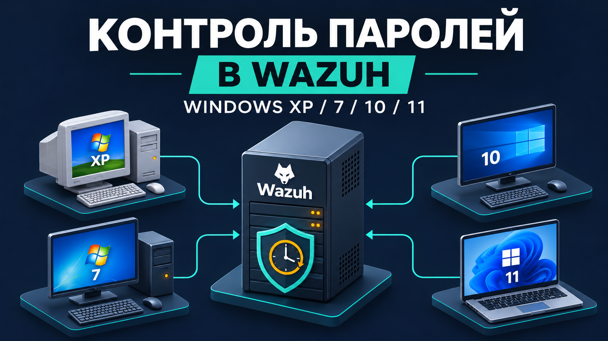
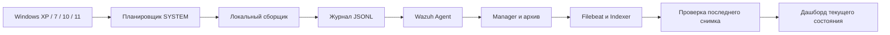
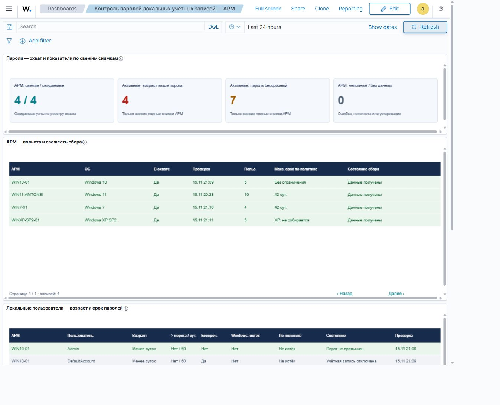

# Контроль паролей четырёх АРМ в Wazuh



Подключаем к лаборатории Wazuh четыре рабочих места на Windows XP SP2, Windows 7, Windows 10 и Windows 11. Настраиваем почасовой сбор сведений о локальных пользователях и общий дашборд контроля возраста паролей без Active Directory.

Сборщики получают метаданные: возраст пароля, индивидуальную бессрочность и доступные признаки истечения. Содержимое и хеши паролей не извлекаем. Учётные записи и парольную политику в ходе внедрения не меняем.

## Материалы проекта

| Материал | Что внутри |
|---|---|
| [Практическая статья](article.md) | Подключение четырёх АРМ, объяснение схемы работы, команды, проверка и эксплуатационные нюансы |
| [Все скрипты и конфигурации](docs/scripts.md) | Каталог 32 файлов с назначением, применением, оригиналом и полным читаемым кодом |
| [Код дашборда](code/dashboard/) | Три спецификации Vega, генератор и импортируемый NDJSON |
| [Порядок импорта дашборда](docs/dashboard-import.md) | Подготовка источника, импорт saved objects и контроль отображения |
| [Архитектура и движение данных](docs/architecture.md) | Наглядные схемы Mermaid и объяснение полного снимка |
| [Проверки и воспроизводимость](docs/reproducibility.md) | Подтверждённые результаты, кодировки и границы проверки |

В `code/` находятся полные исходные файлы. Для VBS в UTF-16LE и других неудобных для просмотра кодировок подготовлены [полные UTF-8-листинги](docs/source-listings/). Представления для чтения не заменяют оригиналы: их байты и кодировки сохранены и проверяются по [SHA256](code/SHA256SUMS.txt).

## Как устроено решение



На АРМ создаём структурированный отчёт. Сервер проверяет его полноту и свежесть, затем публикует текущее состояние. Учётную запись различаем по паре `agent.id + SID`, запуск — по `run_id`. Поздняя ошибка или отсутствие данных остаются видимыми и не превращаются в зелёный результат.

## Контрольный результат

Проверка **15 ноября 2026 года, 21:17:59 по Иркутску**: четыре агента подключены, в архиве, индексе и текущем представлении приняты полные снимки всех четырёх АРМ.

| ОС | Учётных записей | Включено | Старше 60 суток¹ | Индивидуально бессрочных¹ |
|---|---:|---:|---:|---:|
| Windows XP SP2 | 5 | 2 | 0 | 2 |
| Windows 7 | 4 | 2 | 0 | 2 |
| Windows 10 | 5 | 1 | 0 | 0 |
| Windows 11 | 10 | 5 | 4 | 3 |
| **Итого** | **24** | **10** | **4** | **7** |

¹ Учитываем включённые локальные записи. Одна облачная запись Windows 11 исключена из оценки облачного пароля. Показатели возраста и бессрочности пересекаются. Числа относятся к контрольному снимку.



## Что важно при повторении

- Порог 60 суток — условие лабораторного контроля. Для организации выбираем срок по её политике.
- Возраст пароля, флаг бессрочности и истечение по локальной политике оцениваем раздельно. Зелёный статус не подтверждает сложность пароля.
- XP-адаптер не собирает общую парольную политику. Облачный пароль и Windows Hello PIN локально не оцениваем.
- Команды установки применяем к новым АРМ; состояние готовых узлов проверяем через службу, задачу и доставленный снимок.
- На выполненном стенде Manager имеет версию 4.14.9; для Windows 7/10/11 использованы агенты 4.14.9, для XP сохранён 4.13.1. Версии приводим как состав проверенной лаборатории.

## Связанные проекты автора

Работа входит в последовательную лабораторию:

1. [Cisco ASAv в EVE-NG](https://github.com/Amtonsi/cisco-asav-lab) — подготавливаем сетевой стенд, правила доступа, Zabbix и сбор Syslog в Wazuh.
2. [Лаборатория SIEM на Wazuh](https://github.com/Amtonsi/siem-lab) — подключаем Windows XP, журналы и контроль файлов, объединяем АРМ и Cisco ASA; подключение KSC рассматриваем теоретически.
3. **Этот проект** — расширяем состав до четырёх поколений Windows и настраиваем централизованный контроль возраста локальных паролей.

## Состав репозитория

```text
article.md                Практическая статья
assets/images/            Обложка и реальные скриншоты
code/                     Полные оригиналы скриптов и конфигураций
code/dashboard/           Vega, генератор и экспорт дашборда
code/server/              Обработчик состояния и systemd
code/SHA256SUMS.txt        Контрольные суммы 32 файлов
docs/scripts.md           Каталог исходников с пояснениями
docs/source-listings/     Полные читаемые UTF-8-листинги
docs/architecture.md      Схемы и объяснение обработки
docs/dashboard-import.md  Импорт дашборда
docs/reproducibility.md   Подтверждённые проверки и ограничения
```

В репозитории опубликованы 30 исходных файлов и два отдельно обозначенных заполненных примера конфигурации. Рабочие пароли, регистрационные ключи агентов, образы ОС, виртуальные диски и установочные пакеты не входят в публикацию.
