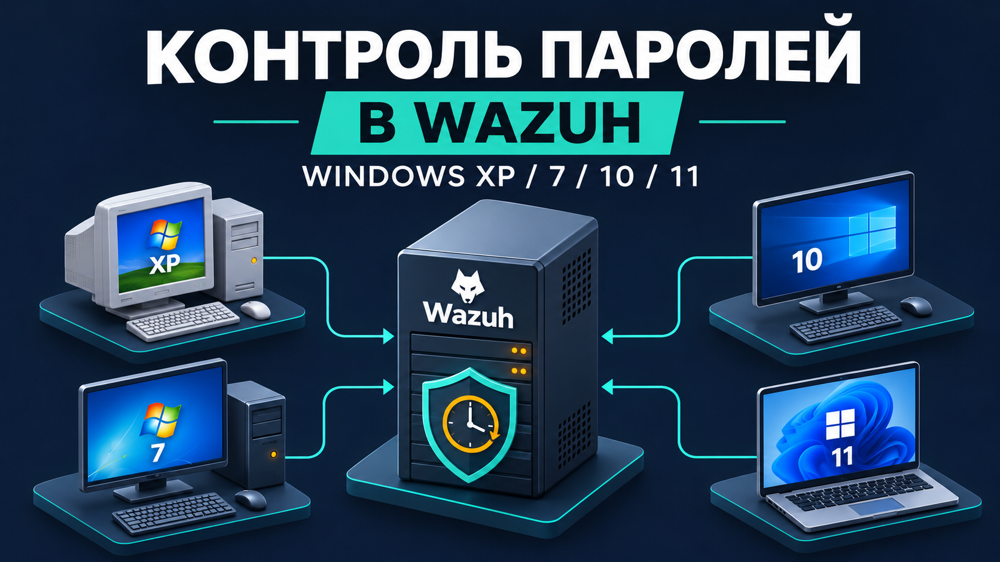
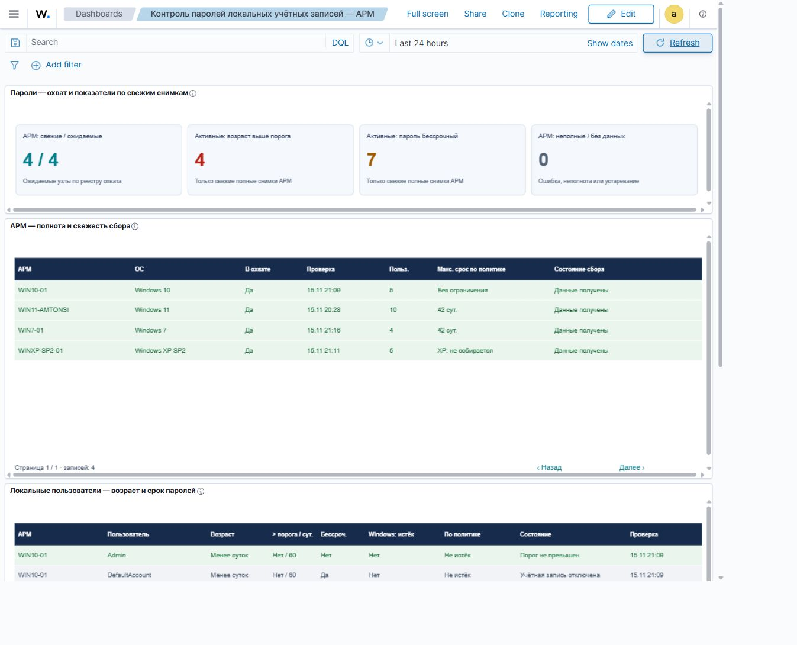
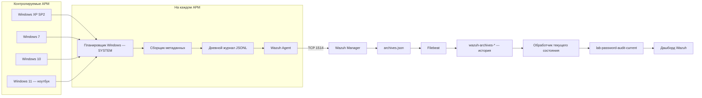
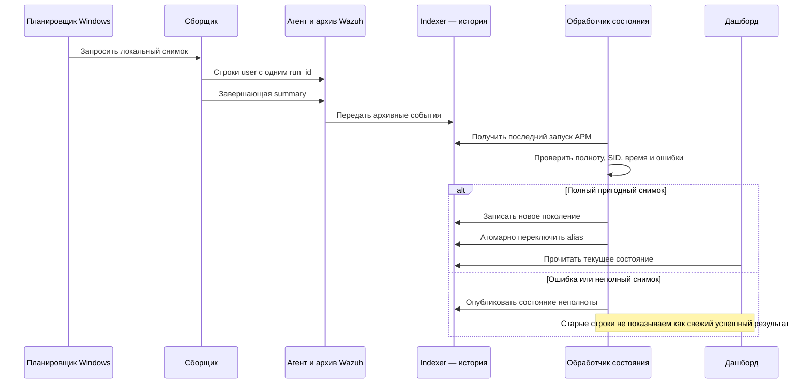
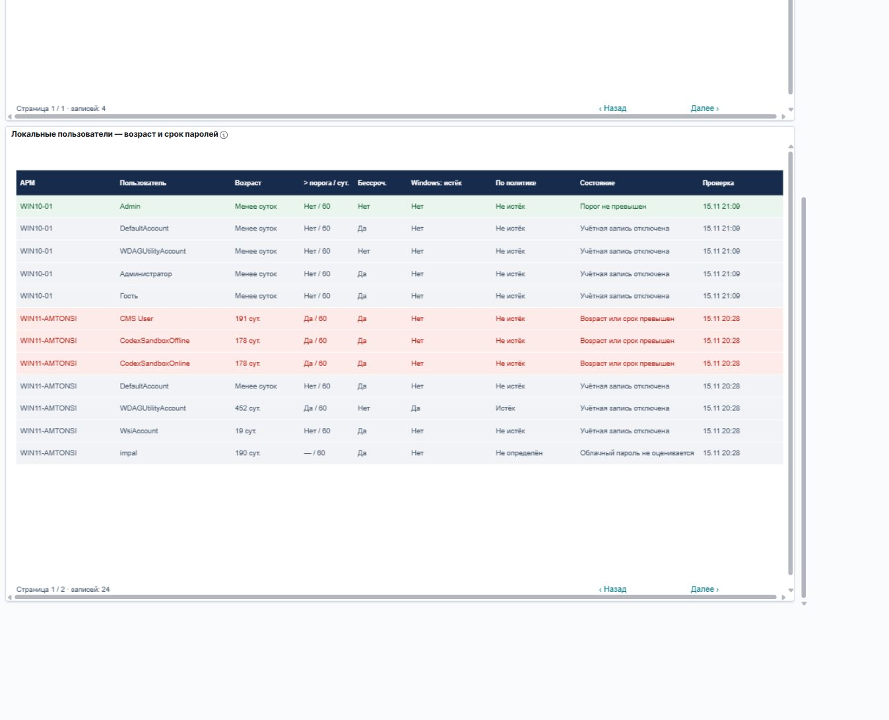

# Четыре АРМ в Wazuh: подключение Windows и контроль возраста паролей



В этой статье подключаем к Wazuh четыре автоматизированных рабочих места: Windows XP SP2, Windows 7, Windows 10 и Windows 11. Затем организуем общий контроль локальных учётных записей: получаем возраст пароля, проверяем превышение выбранного срока, учитываем бессрочность и выводим результат в таблицы SIEM — системы централизованного сбора и анализа событий безопасности.

Работаем без Active Directory. Сведения собираем непосредственно на каждом компьютере, а в Wazuh передаём структурированный отчёт. Содержимое и хеши паролей не извлекаем. Пароли и парольную политику в ходе внедрения не меняем.

Материал рассчитан на читателя, которому требуется повторить лабораторную работу и понять назначение каждого компонента. Полные скрипты, конфигурации и код визуализаций размещены в каталоге [code](code/). Для каждого файла подготовлены пояснения в [каталоге исходников](docs/scripts.md).

## Место проекта в лаборатории

Этот репозиторий продолжает два связанных проекта автора:

1. [Лаборатория Cisco ASAv в EVE-NG](https://github.com/Amtonsi/cisco-asav-lab) — подготовка сетевого стенда, проверка правил доступа, передача Syslog и мониторинг средствами Zabbix и Wazuh.
2. [Лаборатория SIEM на Wazuh](https://github.com/Amtonsi/siem-lab) — подключение Windows XP, сбор журналов, контроль изменений файлов, общий дашборд АРМ и Cisco ASA; интеграция KSC рассматривается как проект.
3. **Текущий этап** — подключение четырёх поколений Windows и построение общего представления о локальных пользователях и возрасте их паролей.

Для выполнения этой работы используем уже подготовленный сервер Wazuh. Образы Windows, виртуальных машин и установочные пакеты в репозиторий не входят. Используем собственные установочные материалы и отдельный регистрационный ключ для каждого АРМ.

## Какой результат получаем

После настройки специалист видит, от каких компьютеров поступили полные свежие сведения, у каких действующих локальных пользователей превышен порог возраста и где установлен индивидуальный признак бессрочного пароля. Отдельно показываем отсутствие данных, отключённые записи и облачную идентичность, пароль которой локально не оцениваем.

Контрольная проверка выполнена **15 ноября 2026 года в 21:17:59 по Иркутску — 13:17:59 UTC**. Получены следующие показатели:

| АРМ | Агент | Всего записей | Включено | Старше 60 суток среди активных локальных | Бессрочных среди активных локальных |
|---|---|---:|---:|---:|---:|
| Windows XP SP2 | `001` | 5 | 2 | 0 | 2 |
| Windows 7 | `002` | 4 | 2 | 0 | 2 |
| Windows 10 | `003` | 5 | 1 | 0 | 0 |
| Windows 11 | `004` | 10 | 5 | 4 | 3 |
| **Итого** | **4 АРМ** | **24** | **10** | **4** | **7** |

Одна включённая запись Windows 11 связана с облачной идентичностью Microsoft и исключена из оценки облачного пароля. Показатели возраста и бессрочности могут относиться к одной учётной записи, поэтому их не складываем в общее количество записей с нарушениями. Эти значения описывают контрольный снимок; последующее состояние проверяем в работающем дашборде.



## Что именно проверяем

Возраст пароля, его бессрочность и истечение срока — самостоятельные признаки.

| Проверка | Смысл |
|---|---|
| Возраст выше 60 суток | Пароль установлен более 60 суток назад; это выбранный порог лаборатории |
| Индивидуальная бессрочность | У пользователя установлен флаг «Срок действия пароля не ограничен» |
| Windows сообщает об истечении | ОС отмечает истечение или необходимость смены пароля |
| Расчёт по локальной политике | Сравниваем возраст с прочитанным максимальным сроком, учитывая исключения |
| Свежесть и полнота | Проверяем пригодность исходных сведений для оценки |

Например, при возрасте 70 суток и политике 90 суток лабораторный порог уже превышен, но срок по локальной политике ещё не истёк. При возрасте 45 суток и политике 42 суток получаем обратную ситуацию. Бессрочный пароль также может превышать организационный порог.

Общий неограниченный срок политики отличается от исключения конкретного пользователя. На нашей Windows 10 максимальный возраст в локальной политике не ограничен, хотя у включённого пользователя индивидуальный флаг бессрочности отсутствует.

Порог 60 суток используем как условие учебного контроля. При переносе решения согласуем его с действующей политикой организации. По метаданным не определяем фактическую длину, сложность или содержимое существующего пароля. Windows Hello PIN и действительный возраст облачного или доменного пароля этим контуром не оцениваем.

## Как устроен сбор

Три гостевые Windows работают в VMware, Windows 11 используется на ноутбуке. Агентам требуется сетевой доступ к Linux-серверу Wazuh; в этой лаборатории Manager доступен по адресу `192.168.179.20`, канал событий — `TCP 1514`.



На АРМ задача запускает сборщик от SYSTEM. Полученный отчёт дописываем в дневной JSONL-файл, где каждая строка является самостоятельным JSON-объектом. Агент читает новые строки и передаёт их Manager. Filebeat отправляет архивные события в Indexer — поисковое хранилище событий.

Историю сохраняем в `wazuh-archives-*`, а текущие таблицы строим через отдельный alias `lab-password-audit-current`. Alias можно представить как постоянное имя актуального набора: серверный обработчик готовит новое поколение данных и переключает это имя только после успешной записи и проверки.

## Почему обычного подсчёта событий недостаточно

При почасовом сборе один пользователь попадает в историю много раз. Поэтому количество событий за сутки не равно количеству пользователей.

Каждую запись пользователя связываем с парой **`agent.id + SID`**. Два локальных пользователя `Admin` на разных компьютерах имеют разные идентификаторы. Каждый запуск сборщика получает отдельный `run_id`.

На пользователя создаём строку `kind=user`, последней записываем `kind=summary`. Сводка сообщает, завершилось ли перечисление и сколько записей ожидалось. При приёме сверяем количество пользовательских строк, уникальность SID, общий `run_id` и признаки полноты. Так отличаем полный отчёт от ситуации, когда дошла только его часть.



Если последний запуск завершился ошибкой, прежний успешный результат не подставляем вместо него как актуальный. Исчезнувшего пользователя удаляем из текущего представления только после получения нового полного снимка.

## Подготавливаем подключения агентов

Версии фиксируем по выполненной работе: Manager `4.14.9`, агенты Windows 7/10/11 `4.14.9`, работающий агент XP `4.13.1`. Перед повторением на другом стенде сверяем фактические версии и доступные возможности ОС.

На сервере проверяем версию и регистрации:

```bash
# Получаем сведения об установленном Manager.
sudo /var/ossec/bin/wazuh-control info

# Создаём отдельную регистрацию для каждого нового АРМ.
sudo /var/ossec/bin/manage_agents

# Проверяем список и фактические ID.
sudo /var/ossec/bin/agent_control -l
```

В нашем реестре используются имена `WINXP-SP2-01`, `WIN7-01`, `WIN10-01` и `WIN11-AMTONSI`. При другом порядке регистрации номера могут отличаться — в конфигурациях указываем фактически выданные ID.

Для комплексного установщика подготавливаем индивидуальный `agent-client.keys` в нативном четырёхпольном формате. Экспорт Base64 из `manage_agents -e` предназначен для штатного импорта и напрямую таким файлом не является. Клонированным АРМ не оставляем один общий ключ. В публичном репозитории приведены только примеры настроек.

## Устанавливаем сбор на Windows 7, 10 и 11

Используем [PowerShell-сборщик](code/collect-password-audit.ps1) и расположенный рядом [модуль Windows API](code/PasswordAudit.Native.cs). Модуль получает сведения о локальных пользователях; PowerShell оценивает признаки и формирует журнал. Зависимость от `Get-LocalUser` отсутствует.

Копируем содержимое каталога `code/` в локальную папку, например `C:\Install\windows-password-audit-v2`. Для новой установки добавляем согласованный MSI `wazuh-agent-4.14.9-1.msi` и индивидуальный файл ключа. Запускаем Windows PowerShell от администратора:

```powershell
# Сначала проверяем расчёты на искусственных данных.
powershell.exe -NoProfile -ExecutionPolicy Bypass `
  -File "C:\Install\windows-password-audit-v2\collect-password-audit.ps1" `
  -SelfTest

# Для нового АРМ выполняем комплексное развёртывание.
powershell.exe -NoProfile -ExecutionPolicy Bypass `
  -File "C:\Install\windows-password-audit-v2\deploy-windows.ps1" `
  -Manager 192.168.179.20 `
  -ThresholdDays 60
```

[Комплексный установщик](code/deploy-windows.ps1) сохраняет резервные копии, настраивает источник JSONL и создаёт задачу `WazuhPasswordAudit`. Для запуска из Проводника предусмотрен [launcher](code/launch-setup.vbs), который запрашивает повышение прав и открывает итоговый журнал. Пароль администратора в launcher не хранится.

Если агент уже зарегистрирован, а требуется разместить только сборщик и задачу, используем отдельный [install-task.ps1](code/install-task.ps1). Он не настраивает регистрацию и `ossec.conf`; источник журнала в таком варианте подключаем отдельно. Эти способы выбираем по состоянию АРМ, а не выполняем последовательно оба.

Рабочая задача запускается от SYSTEM каждый час со случайной задержкой до десяти минут; предусмотрен запуск после загрузки с задержкой пять минут. Одновременные экземпляры игнорируются. Код и журналы размещаются в `C:\SIEM-Audit\Password`, запись в исполняемые файлы ограничивается администраторами и SYSTEM.

Установочные сценарии повторно на уже настроенных четырёх АРМ для обычной проверки не запускаем. Проверку выполняем через состояние службы, параметры задания, новый отчёт и данные сервера. Существующие одноимённые задачи и ключи требуют отдельной сверки перед заменой.

## Настраиваем Windows XP отдельно

На XP используем [VBS-сборщик](code/collect-password-audit-xp.vbs) и сохраняем работающий агент `4.13.1`. Для завершения текущего сценария подготовлен [finish-xp-audit.vbs](code/finish-xp-audit.vbs):

```bat
REM Проверяем сценарий без изменения системы.
cscript.exe //Nologo "C:\Install\windows-password-audit-v2\finish-xp-audit.vbs" /selftest

REM При первоначальной настройке создаём отдельную задачу v2.
cscript.exe //Nologo "C:\Install\windows-password-audit-v2\finish-xp-audit.vbs"
```

Получаем задачу `WazuhPasswordAuditV2` от SYSTEM с периодом один час. Прежнюю задачу v1 и её скрипт сохраняем. Сценарий проверяет имя задания, создаёт backup конфигурации и ожидает готовности агента до запроса контрольного снимка. Принудительную перезапись неизвестного задания не выполняет.

XP-адаптер получает возраст, индивидуальные флаги и доступный признак истечения. Общую локальную парольную политику он не собирает: `policy_read_status=not_collected`. Поэтому вычисленное истечение по общей политике XP оставляем неизвестным.

В контрольном запуске дополнительные поля исполнителя из окружения XP оказались недоступны. Это не нарушило полноту пользовательского снимка: создание SYSTEM/hourly-задания, запуск и результат `0` проверены отдельно. Исходный локальный отчёт с `partial` сохранён; в актуальном сценарии необязательные сведения оформляются предупреждением.

Для VBS сохраняем UTF-16LE с BOM, для вспомогательных CMD — OEM866. Выделенный рабочий каталог размещаем на NTFS. На XP используется классический формат журналов `eventlog`; на новых Windows — `eventchannel`. Аудит паролей во всех случаях передаём отдельным JSONL-источником.

## Подключаем журнал к Wazuh

В действующий `ossec_config` агента добавляем [блок localfile](code/wazuh-localfile.xml):

```xml
<!-- Читаем новые строки дневных JSONL-журналов аудита. -->
<localfile>
  <location>C:\SIEM-Audit\Password\logs\password-audit-*.jsonl</location>
  <log_format>json</log_format>
</localfile>
```

Источник также можно распространять через [групповой agent.conf](code/wazuh-group-agent.conf.example). Один и тот же журнал локально и централизованно не дублируем.

Сохраняем `ossec.conf` в UTF-8 без BOM и XML-пролога. В лабораторном развёртывании добавленный пролог приводил к ошибке нативного парсера. После изменения перезапускаем службу и проверяем состояние:

```bat
net stop WazuhSvc
net start WazuhSvc
sc query WazuhSvc
```

Перед контрольным сбором установщик ожидает подтверждения открытия JSONL и соединения с Manager. Состояния `Running` недостаточно: снимок, созданный до начала чтения файла, может не попасть в поток. Если после применения конфигурации служба останавливается, установщик восстанавливает backup; работающую службу без подтверждённой готовности отмечает как неполный результат развёртывания.

На Manager включаем `logall_json=yes` в существующем блоке `global`, а в модуле Wazuh Filebeat — `archives.enabled: true`. Для таблицы нужны и нормальные результаты, поэтому одного `wazuh-alerts-*` недостаточно. После проверки конфигураций применяем изменения.

```bash
# Проверяем конфигурации перед применением.
sudo /var/ossec/bin/wazuh-analysisd -t
sudo filebeat test config -e
```

Новый журнал использует пространство `password_audit_v2`, после декодирования — `data.password_audit_v2`. Отдельное имя исключает конфликт со старыми числовыми признаками v1: новая схема использует Boolean. Применяем [шаблон индексов](code/indexer-template.http), для уже существующего индекса — [расширение mapping](code/existing-index-mapping.json). Проверяем реальные типы:

```http
GET /wazuh-archives-*/_mapping/field/data.password_audit_v2.*
```

Кириллицу новый сборщик сохраняет через Unicode escapes JSON. Ранее настроенная обработка классических русских журналов XP остаётся отдельным механизмом.

## Публикуем текущее состояние

[Серверный обработчик](code/server/materialize_password_state.py) работает на Linux и читает Indexer. Для запуска достаточно Python 3.8 или новее и стандартной библиотеки. К АРМ по сети этот обработчик не подключается.

Размещаем программу в `/opt/wazuh-password-audit`, а конфигурацию, реестр ожидаемых узлов и файл учётных данных — в `/etc/wazuh-password-audit`. Для конфигураций назначаем владельца запуска службы и права `0600`. Проверку цепочки и имени сертификата Indexer сохраняем включённой.

Используем [заполненный пример конфига](code/server/config.lab.json) и [реестр четырёх АРМ](code/server/expected-agents.lab.json), сверив ID и пути. Файл с действительными учётными данными создаём локально по [шаблону](code/server/indexer-auth.example.json).

Первый проход выполняем вручную:

```bash
sudo /usr/bin/python3 \
  /opt/wazuh-password-audit/materialize_password_state.py \
  --config /etc/wazuh-password-audit/config.json \
  --once
```

После успешной проверки устанавливаем [службу](code/server/wazuh-password-audit-state.service) и [таймер](code/server/wazuh-password-audit-state.timer) в `/etc/systemd/system`:

```bash
sudo systemctl daemon-reload
sudo systemctl enable --now wazuh-password-audit-state.timer
sudo systemctl list-timers wazuh-password-audit-state.timer --no-pager
sudo journalctl -u wazuh-password-audit-state.service -n 30 --no-pager
```

Таймер обновляет представление примерно раз в минуту с небольшим разбросом. Для контроля используются два срока: возраст исходного измерения не более **двух часов** и действительность публикации **пять минут**. При остановке обработчика или обновления страницы зелёный статус не сохраняется бессрочно.

Для регулярной работы задаём `retention_keep_generations=3`: храним три последних собственных производных поколения. В исходном `config.example.json` значение `0` отключает очистку; заполненный лабораторный пример содержит `3`. Эта очистка не затрагивает исходные archives, журналы АРМ и резервные копии — их хранение регламентируем отдельно.

## Собираем и открываем дашборд

Импортируем [Wazuh-Password-Audit-v2.ndjson](code/dashboard/Wazuh-Password-Audit-v2.ndjson) через Saved objects в используемый интерфейсом tenant. В набор входят три визуализации и один dashboard. Код каждой панели доступен отдельно: [KPI](code/dashboard/KPI.vega.json), [АРМ](code/dashboard/HOSTS.vega.json), [пользователи](code/dashboard/USERS.vega.json).

Верхняя строка показывает свежие полные АРМ относительно реестра, активных локальных пользователей с превышением возраста, индивидуальные бессрочные флаги и число АРМ с непригодными или отсутствующими данными.

В таблице АРМ показываем время измерения, количество пользователей, доступные сведения о политике и состояние сбора. Таблица пользователей содержит возраст, порог, бессрочность, признак Windows, расчёт по политике и время проверки.



Красным отмечаем превышение контролируемого возраста или срока. Зелёный означает пригодные сведения без превышения проверяемых условий. Отключённые, облачные, ошибочные и устаревшие записи получают серое состояние. Зелёная строка не подтверждает сложность пароля.

Для dashboard сохранено обновление раз в **60 секунд**. Панели читают текущее представление; общий исторический диапазон и DQL к ним не применяются. Историю просматриваем в Discover по `wazuh-archives-*`. Лимит выборки в 10 000 документов контролируется явно: при усечении KPI не представляют частичный результат как полный. Для большего парка предусматриваем серверную агрегацию или постраничный запрос.

Для воспроизводимого изменения оформления используем [builder.py](code/dashboard/builder.py), затем повторяем сборку и проверку. Импорт визуализаций сам по себе не устанавливает сборщики и не наполняет alias.

## Проверяем доставку от каждого АРМ

На Windows 7/10/11 проверяем службу и задачу, затем запрашиваем контрольный запуск:

```bat
sc query WazuhSvc
schtasks /Query /TN WazuhPasswordAudit /V /FO LIST
schtasks /Run /TN WazuhPasswordAudit
```

Для XP используем `WazuhPasswordAuditV2`; список заданий просматриваем общим `schtasks /Query /FO CSV /V` или через Scheduled Tasks.

В локальном журнале находим новый `run_id`. На сервере проверяем появление этого запуска:

```bash
sudo tail -n 2000 /var/ossec/logs/archives/archives.json \
  | grep -F '"password_audit_v2"'
```

В Discover выбираем `wazuh-archives-*`. Например, для XP ищем:

```text
agent.id: "001" AND data.password_audit_v2.kind: "summary"
```

Сверяем число `user`-строк и уникальных SID с `expected_user_count` и `emitted_user_count`. Затем проверяем, что текущий alias принял тот же последний полный запуск. В производном индексе поля плоские, поэтому запрос строк АРМ выглядит так:

```http
GET /lab-password-audit-current/_search
{
  "size": 100,
  "query": {"term": {"document_kind": "host"}},
  "sort": [{"agent_id": "asc"}]
}
```

Проверяем `host_state`, `snapshot_complete`, `source_run_id`, `accepted_run_id`, `observed_at` и `valid_until`. Статус агента `Active` и код завершения сборщика `0` являются важными этапами, но доставка считается подтверждённой после сверки всей цепочки.

В контрольной проверке для всех четырёх АРМ совпали последние принятые запуски, количество пользовательских строк и SID в физическом архиве, индексе и текущем представлении. Службы Manager, Indexer, Dashboard и Filebeat работали. Дополнительно выполнены чистые проверки Windows x64/x86, серверной логики и Vega. Точная версия PowerShell в живой Windows 7 и длительная серия самостоятельных циклов обновления интерфейса отдельно не измерялись.

## Эксплуатация и границы контроля

Добавляя следующий АРМ, создаём отдельную регистрацию, устанавливаем подходящий сборщик и включаем фактический ID в реестр охвата. После клонирования или переустановки проверяем принадлежность регистрации компьютеру. Если ноутбук находится вне лабораторной сети, учитываем задержку доставки; позднее получение не делает старое измерение новым.

Для XP общая политика остаётся неизвестной. Для Microsoft-связанной записи не оцениваем облачный пароль по локальной копии. Неизвестные результаты не подменяем нулём нарушений. При утрате свежести разбираем причину — расписание, доступ к журналу, соединение, индексацию или серверную публикацию.

Лабораторная проверка показала максимальный локальный срок 42 суток на Windows 7 и 11, отсутствие ограничения на Windows 10; минимальная длина и история на этих трёх АРМ равны нулю. Это прочитанные параметры конфигурации, а не доказательство пустоты или сложности уже установленных паролей. Их изменение является отдельной административной задачей.

Используем резервные копии конкретного АРМ и сохраняем исходные регистрации. Временную HGFS-папку или ISO с индивидуальным ключом после установки отключаем. Секреты и приватные установочные носители не публикуем.

## Полные исходники и справочные материалы

Все файлы размещены по отдельности и доступны для чтения: [каталог скриптов, конфигураций и кода дашборда](docs/scripts.md). Установочные сценарии, сборщики, серверная логика и визуализации сохранены полностью. Заполненные лабораторные примеры отмечены отдельно от исходных шаблонов.

При изучении интерфейсов используем первичные источники: [NetUserEnum](https://learn.microsoft.com/en-us/windows/win32/api/lmaccess/nf-lmaccess-netuserenum), [NetUserGetInfo](https://learn.microsoft.com/en-us/windows/win32/api/lmaccess/nf-lmaccess-netusergetinfo), [параметры локальной политики](https://learn.microsoft.com/en-us/windows/win32/api/lmaccess/ns-lmaccess-user_modals_info_0), [чтение файлов в Wazuh](https://documentation.wazuh.com/current/user-manual/capabilities/log-data-collection/monitoring-log-files.html) и [архивирование событий](https://documentation.wazuh.com/current/user-manual/manager/event-logging.html).