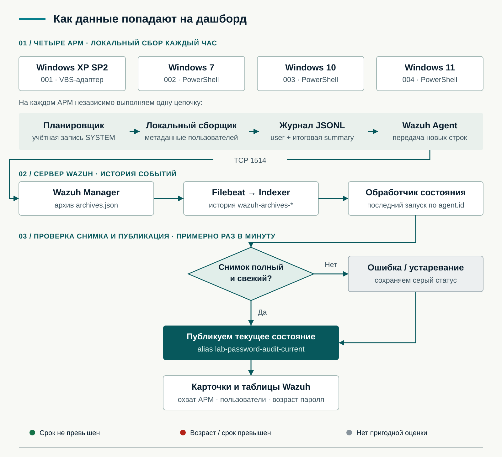
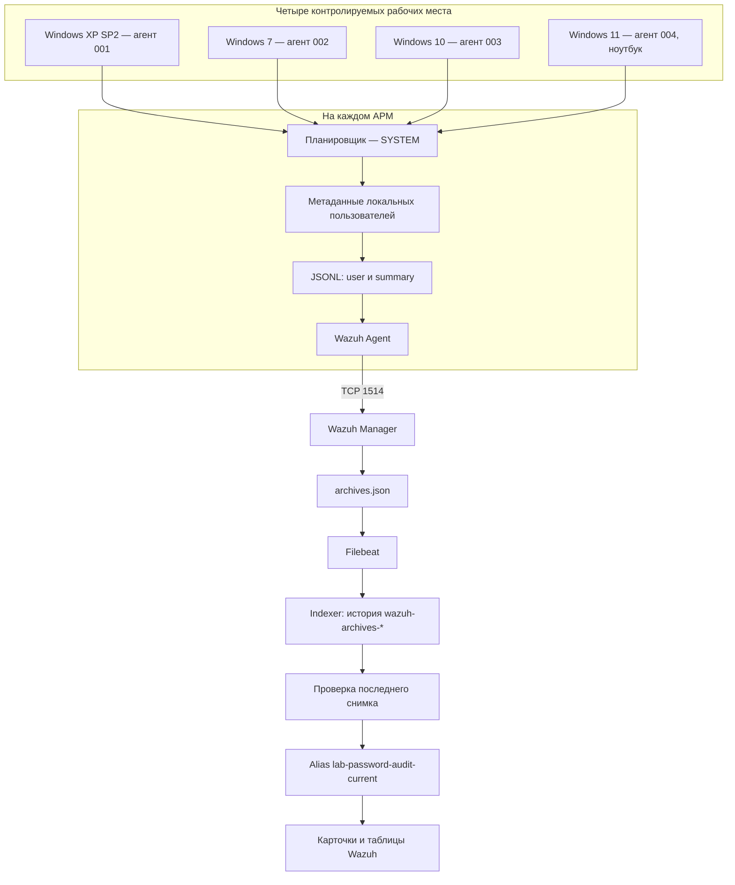
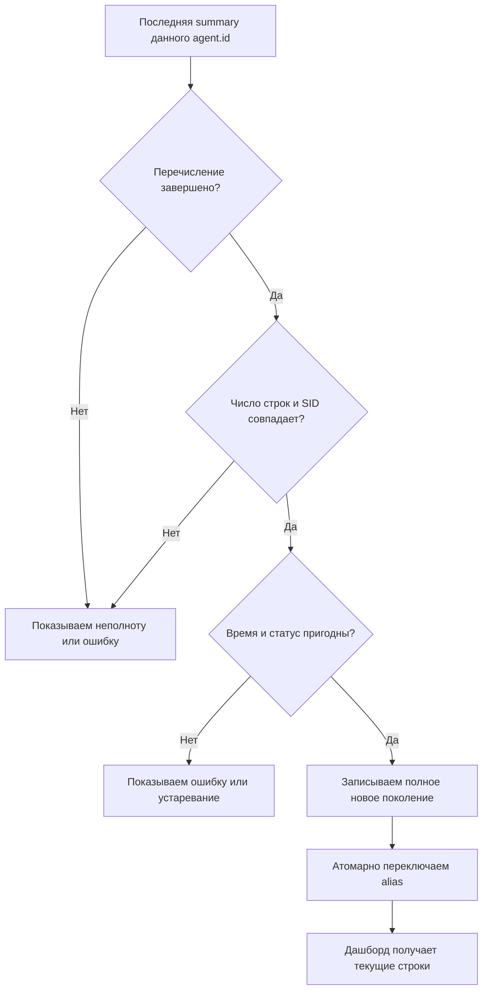

# Как устроен контроль паролей

На каждом АРМ Планировщик запускает локальный сборщик. Сборщик читает метаданные локальных пользователей и дописывает структурированный отчёт в JSONL. Wazuh Agent отправляет новые строки серверу. Внешний доступ к Windows по сети для каждого сбора не требуется.

## Состав лаборатории

Общая цепочка в блоке «На каждом АРМ» выполняется независимо на всех четырёх компьютерах. XP использует отдельный VBS-адаптер, Windows 7/10/11 — PowerShell и модуль Windows API. Расписание АРМ составляет один час; сервер обновляет представление примерно раз в минуту.

## Что считаем полным снимком

Пара `agent.id + SID` различает пользователя, а `run_id` связывает строки одного запуска. Проверяем количество ожидаемых и доставленных пользователей, уникальность SID и результат перечисления. Поздняя ошибка не скрывается прежним успешным снимком. При неполном сборе прежние строки могут сохраняться справочно, но не показываются как свежие успешные результаты.

## Три разных срока

| Срок | Для чего используется |
|---|---|
| Порог пароля — 60 суток в лаборатории | Организационный контроль возраста; выбирается отдельно от настройки Windows |
| Свежесть исходного снимка — 2 часа | Допустимая давность измерения на АРМ |
| Срок публикации — 5 минут | Контроль обновления серверного представления и браузера |

Обновление дашборда сохранено на 60 секунд. Если оператор остановит refresh, старая публикация со временем станет серой даже при работающем сервере. Проверяем обновление и временные отметки, прежде чем делать вывод об отказе всех АРМ.

## Что означает цвет

Красным отмечаем превышение контролируемого возраста или срока у действующей локальной записи. Зелёным показываем пригодный результат без такого превышения. Серым выделяем отключённые, облачные, неполные или устаревшие записи. Цвет не подтверждает сложность фактического пароля.

Возраст выше порога, индивидуальный `never_expires`, сообщение Windows и расчёт по политике сохраняем раздельно. У XP общая политика неизвестна данному адаптеру. Возраст облачного пароля Microsoft и Windows Hello PIN локально не оцениваем.

[Вернуться к статье](../article.md) · [Каталог полного кода](scripts.md)
